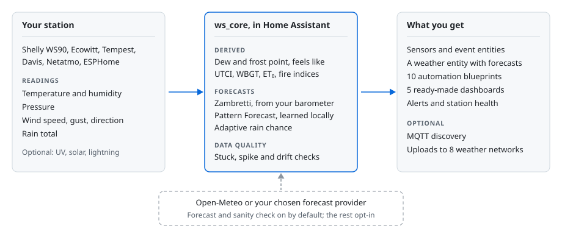
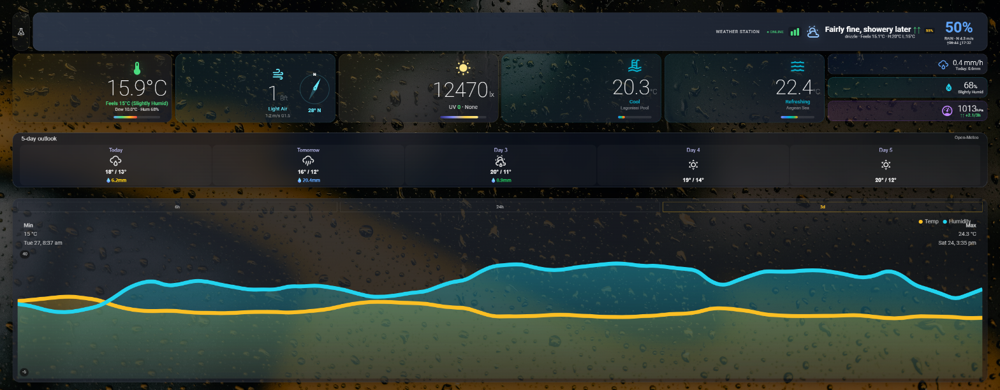
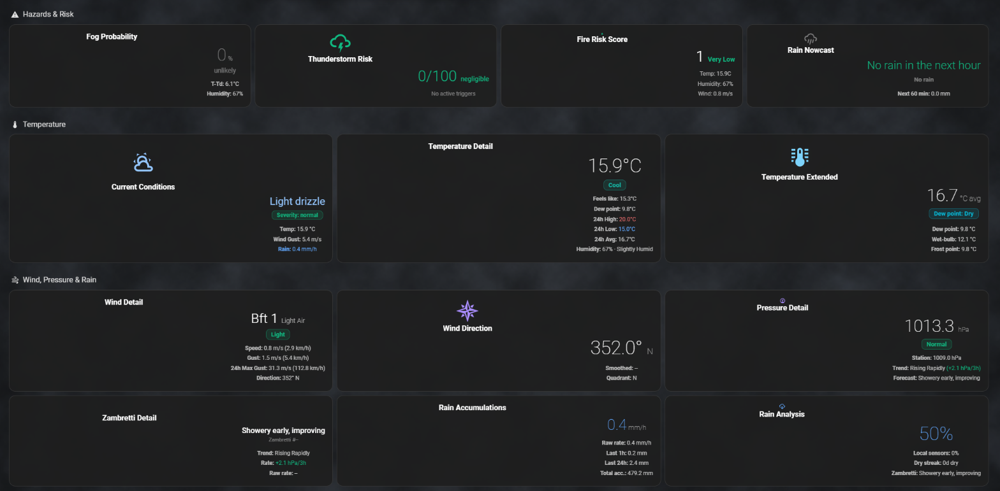
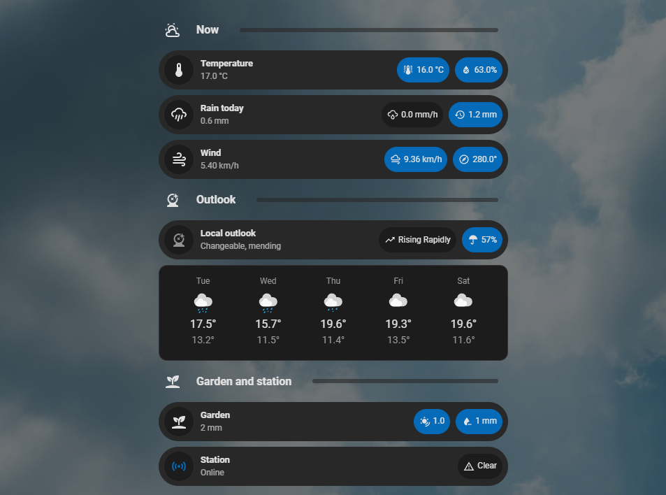
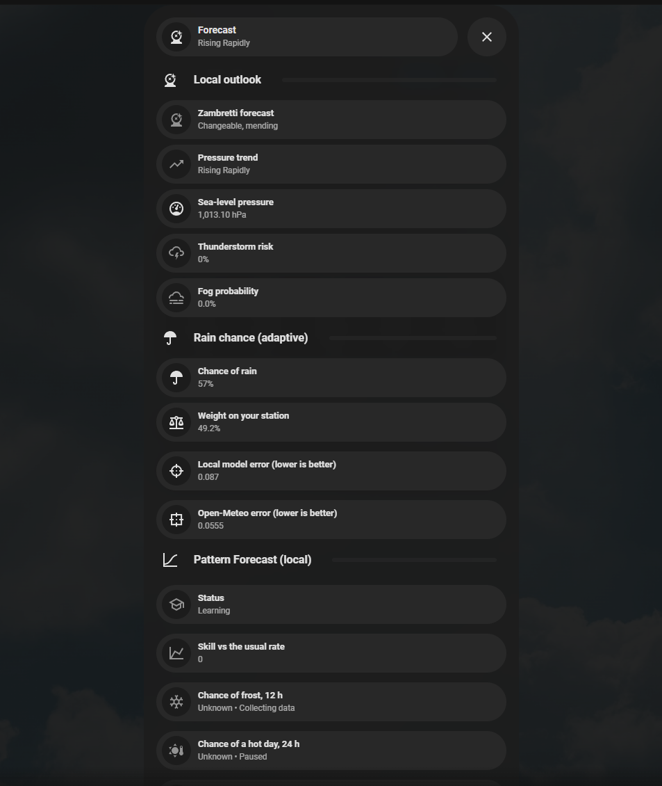

# Weather Station Core (`ws_core`)

[![HACS][hacs-badge]][hacs-url]
[![GitHub Release][release-badge]][release-url]
[![License][license-badge]][license-url]
[![Validate][validate-badge]][validate-url]
[![Translations][translation-badge]][translation-url]

A Home Assistant integration for personal weather stations. It reads the temperature, humidity, pressure, wind and rain sensors your station already provides and calculates the things you'd actually automate on: frost point, heat stress, evapotranspiration for irrigation, fire danger, a barometric outlook, and short-term rain, frost and gust chances learned from your own station's history.

Derived values are calculated inside Home Assistant. By default ws_core also fetches a weather forecast and runs an hourly sanity check against Open-Meteo; both can be turned off, and every other internet feature is opt-in. The [data and privacy table](#data-and-privacy) lists them all.

## What it does

**Rain.** A rain rate filtered from your gauge's running total, totals from the last hour to the year, days since rain and an adaptive rain chance (see [below](#forecasts-that-learn)). The opt-in precipitation nowcast combines Open-Meteo's 15-minute forecast with your gauge for `sensor.ws_minutes_until_rain` and `sensor.ws_minutes_until_dry`.

**Garden and irrigation.** Reference evapotranspiration (FAO-56 Penman-Monteith with a solar radiation sensor, Hargreaves-Samani without one), a water deficit, VPD, Delta-T for spraying, and leaf wetness. The ET₀ sensors can feed [Smart Irrigation](docs/guides/smart_irrigation.md).

**Protection.** Gust alerts for awnings and blinds, frost point (Buck 1981) and freeze warnings, UTCI and WBGT heat stress, and fire danger from the Canadian FWI, McArthur FFDI and Fosberg FFWI.

**Data quality.** Checks for stuck, spiking and drifting sensors, cross-sensor consistency, and a station health summary. When a value can't be calculated, the sensor's `reason` and `explanation` attributes say why.

**Extras you can turn on.** Snow phase and accumulation, heating and cooling degree days, 10-year climate normals (ERA5), air quality, pollen, sea temperature, a solar forecast, lightning, and uploads to Weather Underground, Windy, Weathercloud, PWSWeather, WOW, AWEKAS, CWOP and OpenWeatherMap.

The integration is translated into English, French, German, Spanish, Italian, Dutch, Polish and Portuguese. The formulas and their sources are in the [science documentation](docs/science.md).

## Forecasts that learn

Three features improve with time at your station:

- **Pattern Forecast (opt-in)** learns from your station's own record and gives probabilities: the chance of rain in the next 1, 3 and 6 hours, frost in 12 hours, a hot day in 24 hours, a strong gust in 3 hours and, with a lightning detector, a thunderstorm in 3 hours. It needs time to learn: each sensor reads `unknown` until it has seen enough real events (often straight away if the recorder already has long-term statistics for your sensors), and its `maturity` attribute tells you when it has earned your trust. It is 100% local, apart from one optional, labelled setting that lets the storm forecast use Blitzortung lightning data if you have no detector. See the [guide](https://kmich.github.io/ha_ws_core/guides/pattern_forecast/) and the [method](https://kmich.github.io/ha_ws_core/science/#pattern-forecast).
- **Adaptive rain chance.** `sensor.ws_rain_probability_combined` blends your station's local rain estimate with the forecast provider's. Every 6 hours both are scored against your gauge, and over a rolling 90 days the more accurate source gets more weight. With Station Diagnostics on you can see the weight and both scores. [How it's scored](https://kmich.github.io/ha_ws_core/science/#rain-blend).
- **Adaptive sensor calibration** (opt-in) learns a slow bias in your temperature, humidity and pressure against a regional reference. Once it's confident (about 10 days), it adjusts your calibration offsets by a small, bounded amount at most once a day. You can turn it off or edit the offsets by hand at any time.

## Supported stations

If your station's readings are already in Home Assistant, ws_core can use them. The setup flow suggests matching entities, and you can map any of them by hand.

| Station | Integration | Readings used |
|---|---|---|
| **Shelly WS90** (the maintainer's test station) | Shelly | Temperature, humidity, pressure, wind, gust, direction, rain total, UV, illuminance, battery |
| **Ecowitt / Ambient Weather** | GW-series gateways, WS90, Wittboy, WH57 lightning, soil and rain sensors | Temperature, humidity, absolute pressure, wind, rain, lux or solar radiation, lightning |
| **WeatherFlow Tempest** | Tempest integration, local UDP or MQTT | Temperature, station pressure, wind, gust, rain, UV, illuminance |
| **Davis** | WeatherLink IP, Vantage Pro2, Vantage Vue | Standard station readings, rain year, absolute pressure |
| **Netatmo** | Smart Weather Station with rain and wind modules | Outdoor module, rain gauge total, anemometer |
| **ESPHome and DIY** | Any sensor with a standard device class | Temperature, humidity, pressure, wind, rain total |
| **Blitzortung** (no hardware) | Blitzortung integration, uses internet data | Lightning strikes, distance and proximity, used only when no lightning sensor is mapped |

The [hardware mapping guide](docs/hardware_mapping.md) covers each brand in detail.

## Installation

1. In HACS, open the menu (top right), choose **Custom repositories**, add `https://github.com/kmich/ha_ws_core` as an **Integration**, then download **Weather Station Core** and restart Home Assistant. The button above does the first step for you.
2. Go to **Settings → Devices & Services → Add Integration** and search for **Weather Station Core**.
3. Check the entities it suggests for your station and submit.

More than 50 sensors are created straight away. Optional features are under **Configure → Features**. The [quickstart](docs/quickstart.md) walks through each step.

## Blueprints

Ten automation blueprints with sensible defaults, for example:

| Blueprint | What it does | Import |
|---|---|---|
| **Rain Start Warning** | Phone or TTS alert when rain begins or is imminent |  |
| **Irrigation Rain Skip** | Skips watering when rainfall or ET₀ says the soil doesn't need it |  |
| **High Wind Protection** | Retracts awnings and blinds on strong gusts |  |
| **Freeze Warning** | Alerts before freezing and can shut outdoor water valves |  |
| **Heat Stress Alert** | Alerts when UTCI reaches levels that are dangerous for outdoor activity |  |

The other five (frost, lightning, storm, air quality and fire danger) are in the [blueprint documentation](docs/blueprints.md).

## Dashboards

The `dashboards/` folder has five dashboards and a set of gauge cards. Paste one into a dashboard's raw configuration editor.

| Dashboard | Layout | Custom cards |
|---|---|---|
| **Vanilla** (`weather_dashboard_vanilla.yaml`) | Four views | none |
| **Enhanced** (`weather_dashboard.yaml`) | Animated Weather and Advanced pages, including Pattern Forecast | `button-card` and six others |
| **Full** (`ws_core_dashboard.yaml`) | Six views covering every sensor group | `mushroom`, `mini-graph-card` |
| **Mobile** (`ws_core_dashboard_mobile.yaml`) | Single-column phone layout | `mushroom`, `mini-graph-card` |
| **Bubble** (`ws_core_bubble_dashboard.yaml`) | One centred column on any screen, with pop-ups, an alert banner, the learning stats and an optional weather background | Bubble Card 3.2.0+ |
| **Gauge presets** (`ws_core_gauge_presets.yaml`) | 13 gauge cards to add to your own dashboard | none |

The Enhanced dashboard on a Shelly WS90, Weather page and Advanced page:

The Bubble dashboard on the same station:

| Main page | Forecast pop-up |
|---|---|
|  |  |

The [dashboards guide](https://kmich.github.io/ha_ws_core/dashboards/) describes each one.

## Data and privacy

ws_core sends no telemetry or analytics. These are the only features that contact the internet. **The first two are on by default**; the rest stay off until you enable them.

| Feature | Destination | Data sent | When |
|---|---|---|---|
| **Weather forecast** | Your chosen provider (default Open-Meteo) | Configured coordinates, plus an API key for providers that need one | **On by default.** Turn it off in the integration options, or use an existing Home Assistant weather entity as the provider |
| **Sensor sanity check** (neighbour QC) | Open-Meteo | Configured coordinates | **On by default**, hourly. Turn it off with *Sensor sanity check* or `switch.ws_enable_neighbor_qc` |
| **Adaptive sensor calibration** | Open-Meteo (the same hourly request) | Configured coordinates | If enabled; keeps the hourly request running even with the sanity check off |
| **Precipitation nowcast, air quality, pollen** | Open-Meteo | Configured coordinates | If enabled |
| **Sea temperature, climate normals** | Open-Meteo Marine and Archive APIs | Configured coordinates | If enabled |
| **Solar forecast** | Forecast.Solar | Configured coordinates | If enabled |
| **French Vigilance** | French government geocoder (api-adresse.data.gouv.fr), then OpenDataSoft | Coordinates to the geocoder, then the department code | If enabled |
| **Vigicrues river levels** | Hub'Eau (French government) | Coordinates or the chosen station ID | If enabled |
| **Lightning via Blitzortung** | Blitzortung, through its own integration | Whatever the Blitzortung integration sends | If that integration is installed and no lightning sensor is mapped |
| **Pattern Forecast storm data** (internet lightning) | Blitzortung, through its own integration | Nothing sent by ws_core | If Pattern Forecast is on, no lightning detector is mapped, and you turn on *Use internet lightning data*. The sensor name says so. Every other Pattern Forecast sensor is local |
| **Station network uploads** | The networks you choose (for example WU, WOW) | Station readings and your credentials for that network | If enabled |
| **MQTT discovery** | Your local MQTT broker | Derived sensor values | If enabled |

To run fully offline, turn off the weather forecast and the sensor sanity check and leave the optional internet features off. All locally derived sensors keep working. Diagnostics downloads redact credentials and coordinates.

## FAQ

<b>Why not write template sensors instead?</b>

Templates are fine for simple conversions. Penman-Monteith ET₀, the UTCI polynomial, the fire weather indices and a forecaster that scores itself are a lot of template code to write and maintain, and ws_core also comes with blueprints, dashboards, diagnostics and entity suggestions for common stations.

<b>Can I move over from Thermal Comfort?</b>

Yes. ws_core covers the same comfort indices, and the <a href="docs/migrating_from_thermal_comfort.md">migration guide</a> shows how to keep your entity history.

<b>Do I need an API key?</b>

No. The default forecast and the optional nowcast and air quality features use Open-Meteo's free API, which needs no registration. Some alternative forecast providers need a key.

<b>What happens when a sensor goes offline?</b>

Values that depend on it report <code>unavailable</code> or <code>unknown</code>, with the reason in the sensor's attributes, and everything that doesn't depend on it keeps working.

## Support

- Questions and station setups: [GitHub Discussions](https://github.com/kmich/ha_ws_core/discussions)
- Bugs and feature requests: [GitHub Issues](https://github.com/kmich/ha_ws_core/issues)
- Documentation: [kmich.github.io/ha_ws_core](https://kmich.github.io/ha_ws_core/)

[hacs-badge]: https://img.shields.io/badge/HACS-Custom-orange.svg?style=for-the-badge
[hacs-url]: https://github.com/hacs/integration
[release-badge]: https://img.shields.io/github/v/release/kmich/ha_ws_core?style=for-the-badge
[release-url]: https://github.com/kmich/ha_ws_core/releases
[license-badge]: https://img.shields.io/github/license/kmich/ha_ws_core?style=for-the-badge
[license-url]: https://github.com/kmich/ha_ws_core/blob/main/LICENSE
[validate-badge]: https://img.shields.io/github/actions/workflow/status/kmich/ha_ws_core/validate.yml?branch=main&label=validate&style=for-the-badge
[validate-url]: https://github.com/kmich/ha_ws_core/actions/workflows/validate.yml
[translation-badge]: https://img.shields.io/badge/Translations-8-blue?style=for-the-badge
[translation-url]: https://github.com/kmich/ha_ws_core/tree/main/custom_components/ws_core/translations
